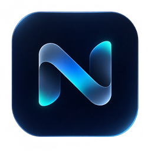

# NORA — CapyRiver Edition

**A local-first Windows AI workspace with the original NORA identity and CapyRiver model labels.**

> **Release · v3.18.4.** NORA will continue to receive updates, though releases may be infrequent. The source and build instructions remain available for owners who need to maintain their own copy.

[English](#english) · [Русский](#русский) · [简体中文](#简体中文)

---

## English

### Overview

NORA is a Windows desktop workspace for local language models, chats, files, coding workflows and optional tool connections. It keeps the NORA name and icon. “CapyRiver” is used as the product label for the included model choices; it does not mean that every underlying weight was trained from scratch by CapyRiver.

The app runs locally by default. A model can still be inaccurate, slow or unable to follow a request. We do not claim that it is broadly smarter than its base model: the 4B option includes the NORA adapter and instruction setup, while the 2B option is an upstream quantized base model. No independent benchmark in this release establishes general superiority.

### Features

- **Local chat and saved conversations** — create chats, resume drafts and export conversation text. Chat history and local settings are stored on the PC.
- **CapyRiver model choices** — the original NORA model catalog remains available, with CapyRiver 2B added alongside it and NORA / CapyRiver Core 4B available through the NORA v3 engine. The 2B GGUF is downloaded on demand and checked against its pinned SHA-256. The 4B option uses the bundled NORA LoRA adapter with its pinned base-model setup.
- **Model engines** — connect supported local runtimes: llama.cpp for GGUF, AirLLM, PEFT/CUDA adapters, or a local LM Studio endpoint. Hardware and runtime support determine which options are usable.
- **Context and response controls** — choose context length, output budget, temperature and response mode. Tool use and reasoning depend on the selected model and can fail on small models.
- **NORA Agent** — a single agent selects relevant instructions from a built-in skills/profile library. It is not hundreds of separate models and does not merge or retrain model weights.
- **Files and project context** — attach local files, add a public GitHub repository as read-only context, and save generated files to a selected folder. File writes and external tools have confirmation controls.
- **MCP connections** — connect compatible MCP services and inspect available tools. A service’s own account permissions and plan still apply. Write-capable tools can change external data when enabled.
- **Browser reading** — read text from public web pages through the app’s browser workflow. It does not provide unrestricted web access; login pages, scripts and some media are unsupported.
- **Code helpers** — generate and review code, run local Python/JSON checks, and use bundled Ruff checks. Static checks do not prove that code is safe or correct. Bandit requires its separate setup where applicable.
- **Images and video** — a configured vision model in LM Studio can analyze images. Video review samples up to four frames and has no audio; events between sampled frames may be missed. MP4 creation assembles selected images with FFmpeg; it is not AI video generation.
- **Memory and feedback** — local notes and feedback can be included in later context. They do not automatically train or change model weights.
- **Interface languages** — Russian, English and Simplified Chinese can be selected in the sidebar. Conversation text, generated answers and code are left as written.

### Model provenance

| App label | What is included | Important detail |
| --- | --- | --- |
| **CapyRiver 2B** | Q4_K_M GGUF, downloaded from a pinned Hugging Face revision | Quantized upstream Qwen3.5-2B base weights; not a custom CapyRiver fine-tune. SHA-256 is checked after download. |
| **NORA / CapyRiver Core 4B** | NORA LoRA adapter and configuration | Adapter based on pinned Qwen3.5-4B weights. The adapter and app instructions are custom; the underlying base model is credited in source and license notices. |

The model may identify its underlying family, produce incorrect answers, or fail at arithmetic and tool calls. Use independent sources for important decisions.

### Windows setup

1. Download **`NORA-CapyRiver-3.18.4-portable.zip`** from the GitHub release and extract the entire folder.
2. Start `NORA.exe`. Keep the adjacent runtime files in the extracted folder.
3. Open **Models** and connect a model. Initial setup downloads the selected weights and checks their integrity; allow enough disk space and time.
4. For the 4B CUDA path, use a compatible NVIDIA GPU and the supported CUDA runtime. Model speed and memory needs vary by hardware.

To build from source, install the .NET 8 SDK and Python 3.11+, then run `build-windows.cmd` on Windows. See the retained third-party notices and model licenses before redistributing components.

### Privacy and limitations

Chats and settings are stored locally by the app. A connection to LM Studio, an MCP service, Hugging Face downloads, or a public web page necessarily sends the request or download traffic to that destination. Review each connection before using it. NORA does not make model output reliable, guarantee offline behavior for every optional feature, or guarantee that an action will succeed.

### Release status

**NORA will continue to receive updates, though releases may be infrequent.**

---

## Русский

### О проекте

NORA — настольное рабочее пространство для Windows: локальные языковые модели, чаты, файлы, программирование и подключаемые инструменты. Приложение сохраняет название и значок NORA. Название **CapyRiver** используется для выбранных моделей и не означает, что все базовые веса обучены CapyRiver с нуля.

По умолчанию приложение работает локально. Модель может ошибаться, отвечать медленно или неверно выполнять запрос. Мы не заявляем, что она в целом умнее базовой модели: вариант 4B включает адаптер NORA и инструкции, а вариант 2B — квантованную базовую модель из открытого источника. Независимый бенчмарк, подтверждающий общее превосходство, в этом выпуске не представлен.

### Возможности

- **Локальный чат и история** — создание диалогов, восстановление черновиков, экспорт текста. История и настройки приложения хранятся на ПК.
- **Модели CapyRiver** — исходный каталог моделей NORA сохранён, а CapyRiver 2B добавлена к нему; NORA / CapyRiver Core 4B доступна через движок NORA v3. GGUF 2B скачивается по запросу и проверяется по закреплённому SHA-256. Вариант 4B использует включённый адаптер NORA LoRA и закреплённую базовую модель.
- **Движки моделей** — поддерживаются локальные варианты llama.cpp для GGUF, AirLLM, PEFT/CUDA и локальный сервер LM Studio. Доступность зависит от оборудования и установленного окружения.
- **Контекст и ответы** — настройка длины контекста, объёма ответа, температуры и режима ответа. Рассуждения и вызовы инструментов зависят от модели и могут давать сбои на маленьких моделях.
- **НОРА Агент** — один агент подбирает инструкции из встроенной библиотеки навыков и профилей. Это не сотни отдельных моделей и не объединение или переобучение весов.
- **Файлы и проекты** — прикрепление локальных файлов, добавление публичного GitHub-репозитория как контекста только для чтения и сохранение созданных файлов в выбранную папку. Запись файлов и внешние инструменты имеют подтверждения.
- **Подключения MCP** — подключение совместимых сервисов и просмотр их инструментов. Ограничения учётной записи и тарифа самого сервиса сохраняются. Инструменты с правом записи могут менять внешние данные.
- **Чтение веб-страниц** — чтение текста публичных страниц через браузерный сценарий приложения. Это не полный доступ к интернету: страницы входа, скрипты и некоторые медиа не поддерживаются.
- **Помощь с кодом** — генерация и разбор кода, локальные проверки Python/JSON и встроенные проверки Ruff. Статический анализ не доказывает безопасность или правильность кода. Для Bandit может потребоваться отдельная установка.
- **Изображения и видео** — подключённая vision-модель в LM Studio может анализировать изображения. Видео просматривается максимум по четырём кадрам без звука; события между кадрами можно пропустить. Создание MP4 собирает выбранные изображения через FFmpeg и не является генерацией видео нейросетью.
- **Память и оценки** — локальные заметки и обратная связь могут попадать в контекст последующих ответов. Они не обучают модель и не меняют веса автоматически.
- **Языки интерфейса** — русский, английский и упрощённый китайский выбираются в боковой панели. Текст диалогов, ответы модели и код не переписываются переводчиком.

### Происхождение моделей

| Название в приложении | Что включено | Важное уточнение |
| --- | --- | --- |
| **CapyRiver 2B** | GGUF Q4_K_M, загружается из закреплённой версии Hugging Face | Квантованные базовые веса Qwen3.5-2B из открытого источника; это не собственный fine-tune CapyRiver. После загрузки проверяется SHA-256. |
| **NORA / CapyRiver Core 4B** | Адаптер NORA LoRA и конфигурация | Адаптер основан на закреплённых весах Qwen3.5-4B. Адаптер и инструкции приложения кастомные; базовая модель указана в исходниках и лицензиях. |

Модель может назвать своё базовое семейство, ошибиться в фактах, вычислениях или вызове инструментов. Для важных решений сверяй ответы с независимыми источниками.

### Установка в Windows

1. Скачай из релиза GitHub архив **`NORA-CapyRiver-3.18.4-portable.zip`** и распакуй всю папку.
2. Запусти `NORA.exe`. Не перемещай runtime-файлы отдельно от приложения.
3. Открой **Модели** и подключи модель. При первой установке выбранные веса загружаются и проверяются; потребуется свободное место и время.
4. Для 4B с CUDA нужна совместимая видеокарта NVIDIA и поддерживаемое CUDA-окружение. Скорость и расход памяти зависят от компьютера.

Для сборки исходников установи .NET 8 SDK и Python 3.11+, затем запусти `build-windows.cmd` в Windows. Перед распространением компонентов изучи сохранённые сторонние уведомления и лицензии моделей.

### Приватность и ограничения

Чаты и настройки приложение хранит локально. Подключение к LM Studio, MCP-сервису, загрузка с Hugging Face или открытие публичной страницы отправляет запросы и сетевой трафик соответствующему назначению. Проверяй подключение перед использованием. NORA не гарантирует правильность ответа, полностью автономную работу всех дополнительных функций или успешность каждого действия.

### Статус выпуска

**NORA будет получать обновления, но новые версии могут выходить редко.**

---

## 简体中文

### 项目简介

NORA 是一款面向 Windows 的本地优先 AI 工作空间，支持本地语言模型、聊天、文件、编程流程和可选工具连接。应用保留 NORA 名称与图标。**CapyRiver** 是模型选项使用的产品名称，并不表示所有底座权重都由 CapyRiver 从头训练。

应用默认在本机运行。模型可能出错、响应缓慢或无法正确执行请求。本版本不宣称模型整体上比底座模型更聪明：4B 版本包含 NORA 适配器和指令配置，2B 版本是来自上游的量化底座模型。本版本没有提供能证明整体性能优势的独立基准测试。

### 功能

- **本地聊天与历史记录** — 创建对话、恢复草稿并导出聊天文本。应用在本机保存聊天记录和设置。
- **CapyRiver 模型选项** — NORA 原有模型目录完整保留，并新增 CapyRiver 2B；NORA / CapyRiver Core 4B 可通过 NORA v3 引擎使用。2B GGUF 按需下载，并按固定版本的 SHA-256 校验。4B 版本使用随应用提供的 NORA LoRA 适配器和固定底座配置。
- **模型引擎** — 支持本地 llama.cpp GGUF、AirLLM、PEFT/CUDA，或本地 LM Studio 端点。可用性取决于硬件和运行环境。
- **上下文与回答控制** — 设置上下文长度、输出预算、温度和回答模式。推理与工具调用取决于所选模型，小模型可能无法可靠完成。
- **NORA Agent** — 单一 Agent 从内置技能与配置文件库中选择相关指令。它不是数百个独立模型，也不会合并或重新训练模型权重。
- **文件与项目上下文** — 添加本地文件、将公开 GitHub 仓库作为只读上下文，并把生成文件保存到所选文件夹。写文件和外部工具操作设有确认步骤。
- **MCP 连接** — 连接兼容的 MCP 服务并查看其工具。服务自身的账号权限和套餐限制仍然适用。启用写入权限后，工具可能修改外部数据。
- **网页阅读** — 通过应用的浏览器流程读取公开网页文本。它不提供无限制的网络访问；登录页面、脚本和部分媒体不受支持。
- **代码辅助** — 生成和检查代码、执行本地 Python/JSON 检查，并使用内置 Ruff 检查。静态检查不能证明代码安全或正确。某些场景需要单独配置 Bandit。
- **图像与视频** — 配置 LM Studio 视觉模型后可分析图像。视频最多抽取四帧且不处理音频，帧间事件可能遗漏。MP4 功能通过 FFmpeg 将所选图像合成为视频，并非 AI 视频生成。
- **记忆与反馈** — 本地笔记和反馈可以加入后续上下文；它们不会自动训练模型或更改权重。
- **界面语言** — 可在侧边栏选择俄语、英语或简体中文。聊天内容、模型回答和代码不会被自动翻译。

### 模型来源

| 应用名称 | 包含内容 | 说明 |
| --- | --- | --- |
| **CapyRiver 2B** | Q4_K_M GGUF，从固定版本的 Hugging Face 下载 | 上游 Qwen3.5-2B 底座权重的量化版本；不是 CapyRiver 自行微调模型。下载后会校验 SHA-256。 |
| **NORA / CapyRiver Core 4B** | NORA LoRA 适配器及配置 | 适配器基于固定版本的 Qwen3.5-4B 权重。适配器和应用指令经过定制；底座模型信息见源代码和许可证说明。 |

模型可能会说明其底座家族，也可能在事实、计算或工具调用方面出错。重要事项请核对独立来源。

### Windows 安装

1. 从 GitHub Release 下载 **`NORA-CapyRiver-3.18.4-portable.zip`** 并完整解压。
2. 运行 `NORA.exe`，请将旁边的运行时文件保留在应用文件夹中。
3. 打开 **Models** 并连接模型。首次安装时会下载所选权重并校验完整性；请预留磁盘空间和下载时间。
4. 4B CUDA 路径需要兼容的 NVIDIA 显卡和受支持的 CUDA 环境。速度和显存需求因硬件而异。

从源代码构建需要 .NET 8 SDK 和 Python 3.11+，然后在 Windows 中运行 `build-windows.cmd`。重新分发前请阅读保留的第三方声明和模型许可证。

### 隐私与限制

聊天和设置保存在本机。连接 LM Studio、MCP 服务、从 Hugging Face 下载模型或访问公开网页时，相关请求和网络流量会发送到对应服务。使用前请检查连接。NORA 不保证回答正确、所有可选功能都完全离线，也不保证每个操作都会成功。

### 发布状态

**NORA 将继续更新，但新版本可能较少发布。**

